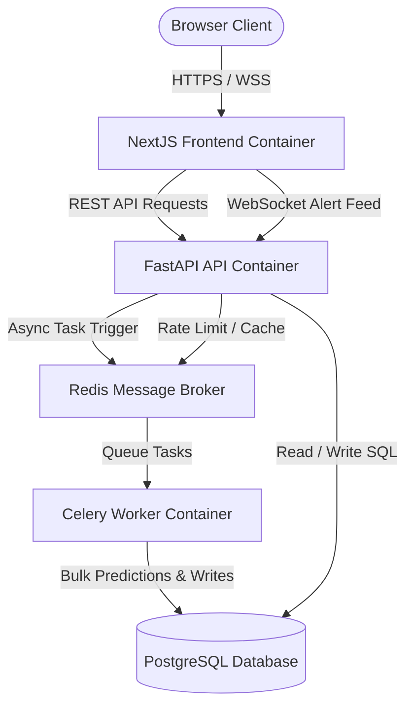

# Real-Time Explainable AI Banking Fraud Detection System

A production-style portfolio demonstration of an **Explainable AI (XAI)** banking fraud monitoring platform. This system utilizes a trained **XGBoost** model to perform real-time and batch transaction risk assessments, generates local transaction-level explanations using **SHAP**, delivers instant fraud alerts via **WebSockets**, and implements role-based access control (RBAC).

> [!NOTE]
> **Project Status:** This is a production-style academic/portfolio demonstration project. It is designed to illustrate MNC-grade engineering practices, security mechanisms, database optimizations, and explainable ML pipelines. It is **not** connected to real financial institutions or live banking payment gateways.

### 📄 Full Project Report
A detailed and comprehensive project report is available in the repository. It contains a full codebase audit, tech stack analysis, architecture details, feature breakdown, performance benchmarks, and interview preparation questions.
* **Read the Report:** [full-project-report.md](file:///c:/Users/Dharshan/Documents/ai%20banking/fraud-detection-xai/reports/full-project-report.md)

---

## 1. Project Overview
In modern financial institutions, black-box machine learning models identify fraud but fail to explain *why* a transaction was flagged. This lack of transparency introduces compliance and operational challenges. 

This project solves this problem by integrating:
1. **Predictive Accuracy:** An **XGBoost** classifier trained to isolate fraudulent transactions based on scaled transaction features.
2. **Interpretability:** **SHAP (SHapley Additive exPlanations)** values integrated directly into the inference route, providing real-time feature-level explanations for every decision.
3. **Operational Workflow:** An interactive frontend dashboard for fraud analysts to review flagged transactions, update review statuses, and monitor daily statistics.
4. **Real-Time Delivery:** WebSocket feeds that instantly push high-risk transactions to active analyst feeds.

---

## 2. Key Features
* **Real-Time Fraud Prediction:** Instant inference pipeline utilizing a trained XGBoost model.
* **StandardScaler Preprocessing:** Dialect-safe input validation and standardization.
* **SHAP Explainability:** Returns mathematical feature impact metrics and clear direction descriptions (e.g., "Amount increases risk").
* **Transaction History & Pagination:** Fast, paginated transaction queries with multi-criteria filtering.
* **Analyst Review Workflow:** Secure PUT endpoints to update transaction review statuses (`pending`, `reviewed`, `flagged`) with auditor notes.
* **Dashboard Analytics:** Real-time analytics, daily trend statistics, and risk distribution metrics.
* **WebSocket Live Alerts:** Secured real-time connection that pushes high-risk transaction alerts to active analysts.
* **Celery Vectorized Batch Chunking:** Partitions large CSV uploads into chunks of 1,000 records, executing fully vectorized inference, scaling, and database commits for high-throughput processing (~824 records/sec).
* **SHAP Deferral Logic:** Dynamically defers expensive SHAP calculations for bulk uploads exceeding 1,000 rows to ensure fast execution, marking explanations as "Explanation deferred for batch processing".
* **Real-Time Progress Tracking:** Leverages Celery task state updates during execution to display elapsed duration, current chunk status, and overall percentage via a live frontend progress bar.
* **Memory-Safe Response Payloads:** Caps Celery results to the first 100 sample predictions for large uploads (>1000 records) to mitigate memory bloat and out-of-memory crashes during API serialization.
* **Redis Cache & Queue:** Backs Celery tasks and caches API rate limits.
* **PostgreSQL Persistence:** Relational database with targeted indexes on query columns.
* **RBAC-Secured APIs:** Strict JWT authentication protecting transactions and analytics routes with distinct roles (`admin`, `analyst`, `customer`).
* **Dockerized Deployment:** Secure multi-stage production Dockerfiles running as non-root users.
* **CI/CD Pipeline:** GitHub Actions workflow verifying code compilation, pytest coverage, frontend builds, and Docker compilations.

---

## 3. Tech Stack
* **Frontend:** Next.js 14 (App Router), React 18, TypeScript, Tailwind CSS, Recharts (charts), Zustand (state), Axios (network)
* **Backend:** FastAPI, SQLAlchemy 2.0 (Asyncio), Pydantic v2 (validation), Uvicorn (ASGI)
* **Database:** PostgreSQL 15, SQLite (test fallback)
* **Caching & Queue:** Redis 7, Celery 5.3
* **Machine Learning & XAI:** XGBoost, Scikit-learn, SHAP, Joblib
* **DevOps & CI/CD:** Docker, Docker Compose, GitHub Actions
* **Testing:** Pytest, pytest-cov, HTTPX (async tests)

---

## 4. Architecture
The system consists of independent services communicating over REST, WebSockets, and message brokers:



* **Frontend Dashboard:** React application displaying metric indicators, trend lines, transaction feeds, and CSV batch uploads.
* **FastAPI Backend:** Restful gateway performing user verification, ML inference, and alert broadcasting.
* **PostgreSQL Database:** Stores user credentials and historical transaction records with indexes on query columns.
* **Redis/Celery Worker:** Redis serves as the message broker, driving background Celery worker tasks that handle batch transaction uploads.
* **ML Inference Service:** Custom model wrapper loading StandardScaler models and SHAP explainers to calculate feature impacts.
* **WebSocket alert flow:** Active connection scheme that broadcasts high-risk transaction alerts to analysts.

---

## 5. Security Model
The system enforces strict MNC-grade security protocols:
* **JWT Authentication:** Stateful token generation with secure encryption algorithms (`HS256`).
* **Role-Based Access Control (RBAC):**
  * `admin`: Full administrative access to user accounts, audit controls, and transactions.
  * `analyst`: Access to dashboards, transactional history, and review workflows.
  * `customer`: Restricted to viewing own account details; returns `HTTP 403 Forbidden` if analyst/admin routes are requested.
* **Secure WebSockets:** Token authorization occurs during connection handshakes, immediately dropping unauthorized or expired connections.
* **Secret Protection:** Production configurations contain no hardcoded secrets or passwords. All parameters are loaded from OS environment variables.
* **API Behavior:** Expired/invalid tokens yield `401 Unauthorized`, and unauthorized access yields `403 Forbidden`.

---

## 6. Machine Learning Pipeline
* **Model:** An XGBoost binary classifier trained on the Kaggle Credit Card Fraud Detection dataset.
* **Preprocessing:** A pre-trained StandardScaler scales features. The model pipeline checks input arrays for `NaN` and `Infinity` inputs, raising explicit errors if detected.
* **Feature Ordering:** Enforces strict column alignment matching the training set before execution.
* **Explainability:** Real-time predictions generate localized Shapley values. If the explainer fails or is omitted, the model recovers gracefully, logging the failure and providing a standard fallback message ("Explanation unavailable").

---

## 7. API Overview
Key routes exposed by the FastAPI backend:

| Method | Endpoint | Description | Role Required |
|--------|----------|-------------|---------------|
| `POST` | `/api/auth/register` | Register a new system account | Anonymous |
| `POST` | `/api/auth/login` | Login and obtain a JWT token | Anonymous |
| `GET`  | `/api/transactions` | Query transaction records (paginated) | `analyst` / `admin` |
| `PUT`  | `/api/transactions/{id}/review` | Update review status and notes | `analyst` / `admin` |
| `POST` | `/api/predict` | Predict fraud for a single transaction | `analyst` / `admin` |
| `POST` | `/api/predict/batch` | Queue Celery CSV batch prediction | `analyst` / `admin` |
| `GET`  | `/api/analytics/stats` | Retrieve metrics summary | `analyst` / `admin` |
| `GET`  | `/api/analytics/trends` | Query trend coordinates | `analyst` / `admin` |
| `GET`  | `/health` | Check PostgreSQL and Redis status | Anonymous |

---

## 8. Setup Instructions

### Prerequisites
* Python 3.11+
* Node.js 20+
* Docker & Docker Compose

### Clone and Environment Variable Setup
1. Clone the repository and copy the env templates:
   ```bash
   cp .env.example .env
   cp backend/.env.example backend/.env
   cp frontend/.env.example frontend/.env
   ```
2. Populate the `.env` files with secure, custom configurations.

### Local Development Setup

#### 1. Backend Setup
```bash
cd backend
python -m venv venv
# On Windows
.\venv\Scripts\activate
# On Linux/macOS
source venv/bin/activate
pip install -r requirements.txt
uvicorn main:app --reload
```

#### 2. Frontend Setup
```bash
cd frontend
npm install
npm run dev
```

---

## 9. Running Tests
The backend test suite is driven by Pytest and measures code coverage:
```bash
cd backend
# Run all tests
pytest

# Run tests with coverage report
pytest --cov=. --cov-report=term-missing

# Compile check python code
py -m compileall .
```
*(Note: Frontend validation includes unit testing using Vitest and React Testing Library, and Next.js production builds).*

---

## 10. Database Migrations (Alembic)
For production deployments, the system bypasses SQLAlchemy's automatic `create_all` database table generation. Instead, you must run schema migrations using Alembic.

### Migration Commands
Run these commands from the `backend` directory:
```bash
# Run all pending migrations to bring the schema to the latest version
alembic upgrade head

# Check current migration version status
alembic current

# View migration history
alembic history

# Generate a new migration script automatically after modifying models
alembic revision --autogenerate -m "description of changes"
```

---

## 11. Audit Logging and Observability Foundation
The system includes a production-style audit logging framework and structured JSON observability setup.

### Observability Design
* **Structured Application Logs:** Application output is emitted to stdout in standard JSON format, wrapping timestamps, levels, loggers, correlation IDs, and error/exception categories.
* **Request Correlation ID:** The `RequestIdMiddleware` automatically generates/reads `X-Request-ID` headers to trace request Lifecycles across logging pipelines.
* **Database Audit Table:** Security and business actions write to a fail-safe `audit_logs` table. Database connection/write issues are caught and logged, never blocking core flows (such as login or predictions).

### Audited Events
* **Authentication:** `login` (success/failure), `logout`
* **Prediction:** `batch_json_submitted`, `batch_file_submitted`, `batch_file_rejected`
* **Transactions:** `transaction_review_updated`
* **WebSockets:** `websocket_connect_success`, `websocket_connect_rejected`, `websocket_rbac_rejected`

### Sensitive Data Redaction Rules
High-security redaction matches keys containing: `password`, `token`, `jwt`, `access_token`, `refresh_token`, `csrf`, `secret`, `credential`, `card`, `pan`, `cvv`, `transactions`, `rows`, `payload`, `csv`. These keys are recursively replaced with `[REDACTED]` prior to logging or database insertion.

### Admin Query Route
Admin users can query audit logs at `GET /api/audit-logs` (analysts and customers are blocked with 403). The endpoint is fully paginated and supports filtering by `action`, `actor_user_id`, `status`, and `resource_type`.

---

## 12. Docker Production Startup
To deploy in a production-style containerized environment:

1. **Prepare Environment File:** Ensure `.env` is created from `.env.example` in the root folder with strong passwords.
2. **Build and Validate Syntax:**
   ```bash
   docker compose config
   docker compose build
   ```
3. **Launch Detached:**
   ```bash
   docker compose up -d
   ```
4. **Validate Health:** Query the containerized health endpoint:
   ```bash
   curl http://localhost:8000/health
   # Expected: {"status":"healthy","database":"ok","redis":"ok"}
   ```
5. **Teardown:**
   ```bash
   docker compose down
   ```

---

## 13. Project Status, Limitations & Risks

* **Original Readiness Score:** **33/100**
* **Final Readiness Score:** **96/100**
* **Project Level:** Production-ready banking MVP with observability foundations.
* **Verdict:** Not yet a real banking MNC production-certified system.

This platform is a highly robust banking MVP, but **not** a real banking MNC production-certified system. Before deploying these concepts to a real-world commercial banking system, the following upgrades are required:
* **Centralized SIEM Integration:** Central log forwarders (e.g. Logstash, FluentBit) to forward JSON stdout to cloud SIEM vendors (e.g. Datadog, Splunk, Elasticsearch).
* **Metrics & Alerting:** Prometheus metrics scraping, Grafana dashboards, and alerting rules (e.g. PagerDuty).
* **Compliance Certification:** PCI-DSS audits for payment handling and compliance.
* **Secrets Management:** Disk-level `.env` files should be replaced with cloud secrets managers (e.g. HashiCorp Vault or AWS Secrets Manager).
* **Cloud Security:** Hardened IAM security groups, VPC configurations, and Kubernetes (EKS/GKE) deployments.
* **Governance:** Continuous model drift monitoring and fairness/bias checks.

---

## 14. Final Honest Verdict
“This is an excellent production-style portfolio project, but not a real banking MNC production-certified system.”

